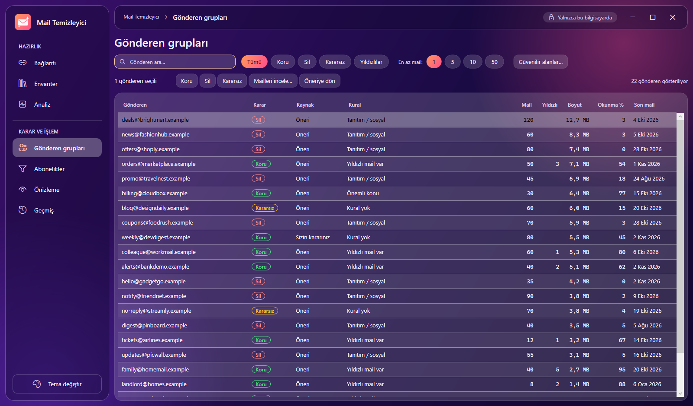
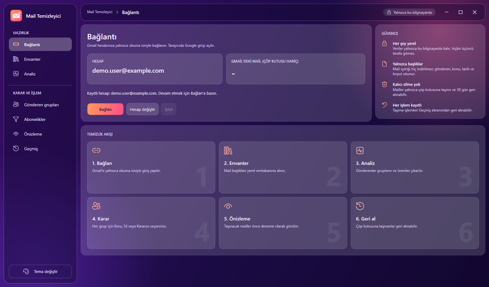
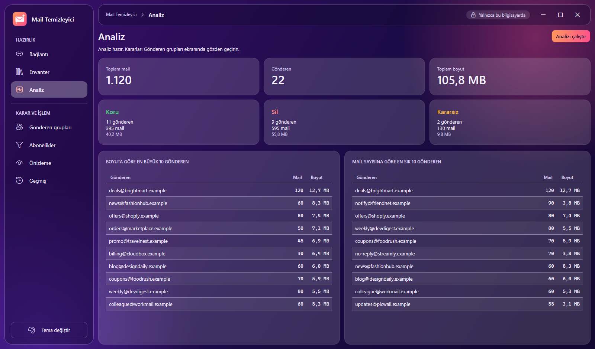
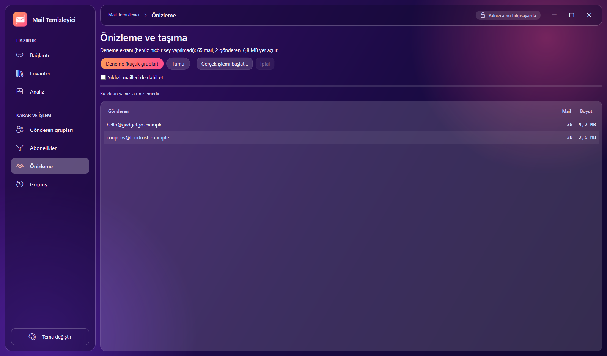
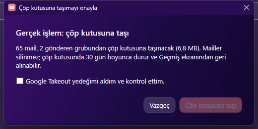
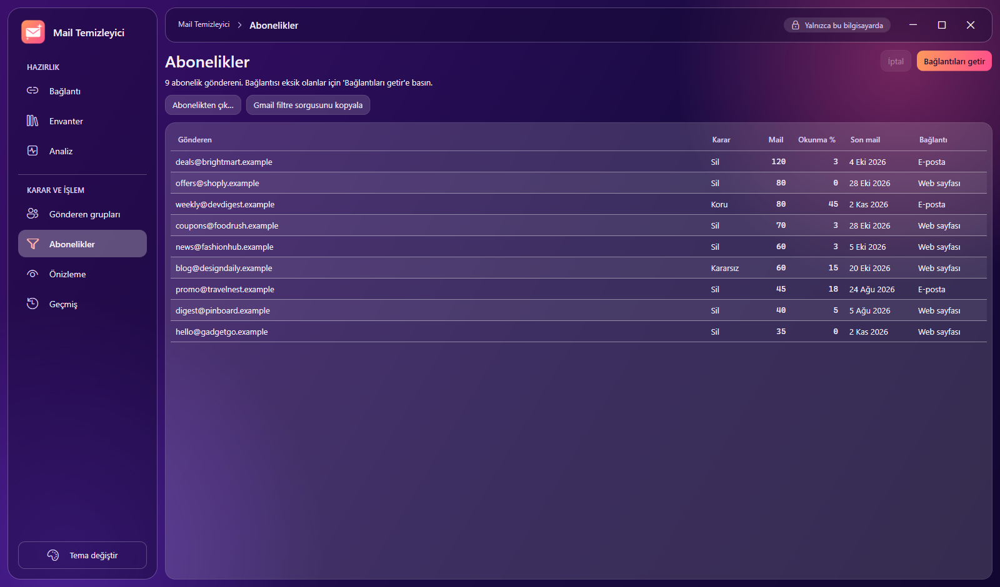
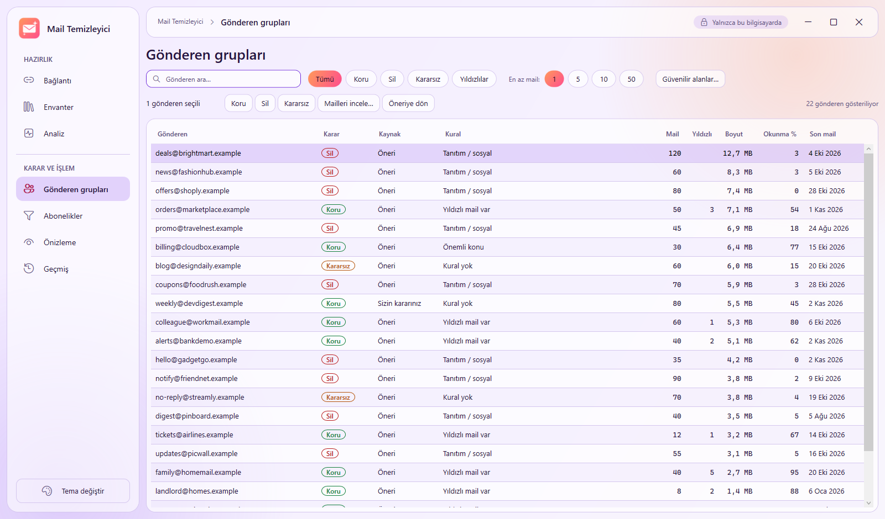
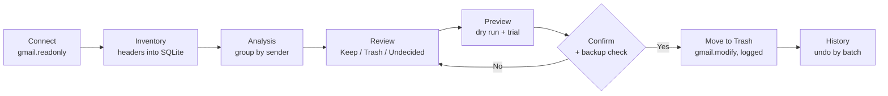

# Mail Temizleyici

**A local-only Windows desktop app that analyzes a long-used Gmail mailbox and, with your approval, moves unwanted mail to Trash. Nothing is ever deleted permanently, mail bodies are never downloaded, and no third party gets access.**

[Türkçe README](README.tr.md)

[](https://github.com/CenkCey/mail-temizleyici/actions/workflows/ci.yml)




> Mail Temizleyici is an independent open-source project. It is not affiliated with, endorsed by or
> sponsored by Google. "Gmail" and "Google" are trademarks of Google LLC. You use your **own** Google
> Cloud project and OAuth client; nothing is shared with the author or anyone else.

## Why

After years of newsletters, notifications and promotions, a mailbox holds tens of thousands of mails
and you cannot tell which ones matter. Bulk-delete tools are risky: they are online services with full
access to your mail, and a wrong rule can destroy something important. Mail Temizleyici takes the
opposite approach:

- **Read first, act later.** It starts with read-only access and builds a local picture of your mailbox.
- **Decisions per sender, not per mail.** You review groups like "promotions from shop X" instead of
  tens of thousands of single messages.
- **Trash, never delete.** Mail goes to Trash (recoverable for 30 days) and every move can be undone
  from the app's own log.
- **You have the last word.** The tool suggests; a dry-run preview and an explicit confirmation come
  before every real action.

## Features

| Area | What it does |
| --- | --- |
| Inventory | Pulls message headers (sender, subject, date, size, labels) into a local SQLite database. Resumable, quota-aware, shows speed and time left. "Fetch new mail" picks up only what arrived since. |
| Analysis | Groups mail by sender, computes counts, sizes, read ratios and suggests Keep, Trash or Undecided from transparent rules. |
| Sender groups | Filterable table with search, decision filters, starred filter, minimum count, bulk decisions, a per-sender mail list that opens a mail in Gmail, and an editable allowlist of trusted domains. |
| Subscriptions | Lists senders with a `List-Unsubscribe` header, fetches the unsubscribe links, copies a ready-made Gmail search query for filters. |
| Preview and trash | Dry-run by default. A trial mode moves only a few small groups first. A confirmation dialog (default button: cancel) and a backup reminder precede the real move. |
| History and undo | Every move is logged per batch; undo restores the original labels. |
| Multi-account | One database per Gmail account; switching account resets every screen to that account's own data. |
| Look and feel | Dark and light themes, glass-style panels, keyboard accessible, themed title bar. |

## Screenshots

| | |
| --- | --- |
|  |  |
|  |  |
|  |  |

All screenshots use fictional demo data (`*.example` addresses) produced by `tools/DemoData`.

## How it works



Rules are evaluated top to bottom and **Keep rules always win over Trash rules** (starred mail, people
you replied to, your own labels, allowlisted domains, important subjects such as invoices or
tickets, attachments). Only then promotions, social mail, silent newsletters and old notifications are
suggested for Trash. Everything the rules cannot place stays *Undecided* and is never touched
automatically. Details: [docs/CLASSIFICATION.md](docs/CLASSIFICATION.md).

## Safety by design

1. Mail is only ever moved to Trash (`batchModify`). `messages.delete`, `batchDelete` and the
   `https://mail.google.com/` scope appear nowhere in the code.
2. Only `gmail.readonly` until you reach the trash step; then `gmail.modify` with a separate sign-in.
3. Headers only: `From`, `To`, `Subject`, `Date`, `List-Unsubscribe`. Bodies are never downloaded.
4. Secrets (`client_secret.json`, tokens) live outside the repository, in your user profile.
5. Every real action is preceded by a dry run and an explicit confirmation whose default is "cancel".
6. Every move is logged before it happens, so undo always works from the log.
7. Keep beats Trash; an Undecided group is never processed automatically.
8. Quota errors are retried with exponential backoff; an interrupted inventory resumes where it stopped.

More in [docs/SAFETY.md](docs/SAFETY.md) and [SECURITY.md](SECURITY.md).

## Quick start

Requirements: Windows 10/11, [.NET 8 SDK](https://dotnet.microsoft.com/download/dotnet/8.0) (or the
.NET 8 Desktop Runtime to run a published build), a Google account, a free Google Cloud project.

1. **Back up your mail** with [Google Takeout](https://takeout.google.com) (only "Mail").
2. **Create your own OAuth client** (Desktop app) and place `client_secret.json` in
   `%APPDATA%\MailTemizleyici\`. Step by step: [docs/SETUP.md](docs/SETUP.md).
3. **Build and run:**

   ```
   git clone https://github.com/CenkCey/mail-temizleyici.git
   cd mail-temizleyici
   dotnet run --project src/MailTemizleyici.Desktop
   ```

4. Follow the screens from top to bottom in the left menu. The full walkthrough with screenshots is in
   the [user guide](docs/USER_GUIDE.md).

To publish a runnable folder:

```
dotnet publish src/MailTemizleyici.Desktop -c Release -r win-x64 --self-contained false -o publish
```

### Try it without a mailbox

```
set MAILTEMIZLEYICI_DATA_DIR=%TEMP%\mail-temizleyici-demo
dotnet run --project tools/DemoData
dotnet run --project src/MailTemizleyici.Desktop
```

This loads a fictional mailbox so you can click through every screen. Your real data folder is not touched.

## Speed and quotas

The Gmail API limits each user to 6,000 quota units per minute and reading one message's headers
costs 20 units, so the hard ceiling is about 300 mails per minute (a 100,000-mail mailbox takes
roughly six hours; the inventory resumes if you stop). The app targets 90 percent of that limit, retries
only failed requests and saves every chunk immediately. Background and measurements:
[docs/INVENTORY_SPEED.md](docs/INVENTORY_SPEED.md).

## Tech stack

C# 12 on .NET 8 · WPF with MVVM ([CommunityToolkit.Mvvm](https://github.com/CommunityToolkit/dotnet)) ·
Gmail API v1 ([Google.Apis.Gmail.v1](https://github.com/googleapis/google-api-dotnet-client)) ·
SQLite ([Microsoft.Data.Sqlite](https://learn.microsoft.com/dotnet/standard/data/sqlite/)) ·
xUnit · GitHub Actions. No telemetry, no other network calls.

## Project layout

```
src/MailTemizleyici.Core      Gmail, SQLite, classification, throttling, undo (UI independent)
src/MailTemizleyici.Desktop   WPF views and view models, themes, assets
tests/MailTemizleyici.Tests   xUnit tests for Core (Gmail is always faked)
tools/DemoData                Writes a fictional demo mailbox into a scratch folder
docs/                         Guides, architecture, safety, design, classification rules
```

## Documentation

- [User guide](docs/USER_GUIDE.md) · [Kullanım kılavuzu (Türkçe)](docs/USER_GUIDE.tr.md)
- [Setup: Google Cloud and OAuth](docs/SETUP.md) · [Kurulum (Türkçe)](docs/KURULUM.md)
- [Architecture](docs/ARCHITECTURE.md) · [Safety model](docs/SAFETY.md) · [Classification rules](docs/CLASSIFICATION.md)
- [AI-assisted development](docs/AI_ASSISTED_DEVELOPMENT.md) · [Yapay zeka ile geliştirme (Türkçe)](docs/AI_ASSISTED_DEVELOPMENT.tr.md)
- [Design system](docs/DESIGN.md) · [Inventory speed research](docs/INVENTORY_SPEED.md) · [Roadmap](docs/ROADMAP.md)

## Limitations

- Windows only (WPF). The Core library and tests are cross-platform.
- The UI is in Turkish. Translating is a matter of resource strings; contributions are welcome.
- The OAuth consent screen stays in "Testing" mode (your own account is the test user), so Google asks
  you to sign in again about every 7 days.
- Inventory speed is bound by the Gmail API quota, not by the app.
- It only looks at headers, so it cannot judge content. That is deliberate.

## Built with AI assistance

Most of this code base was written with an AI coding assistant (Claude Code) under human direction, and
checked with tests, reviews and live use. How the tools were used, who decided what and what went wrong
along the way: [docs/AI_ASSISTED_DEVELOPMENT.md](docs/AI_ASSISTED_DEVELOPMENT.md).

## Contributing, security, license

See [CONTRIBUTING.md](CONTRIBUTING.md), [SECURITY.md](SECURITY.md) and [LICENSE](LICENSE) (MIT).
