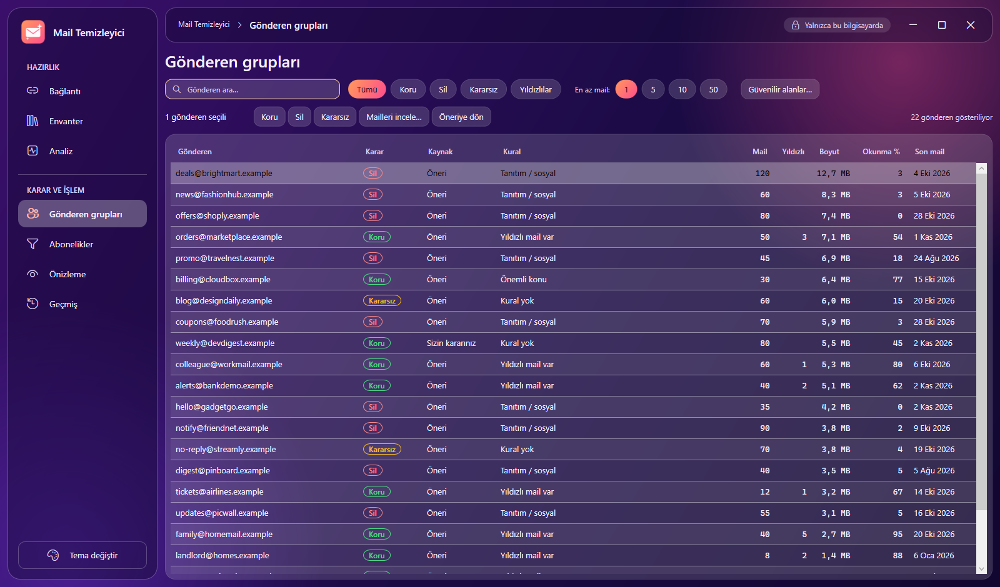
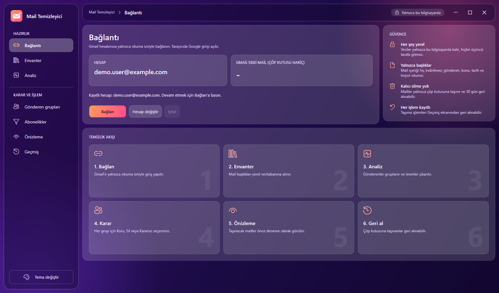
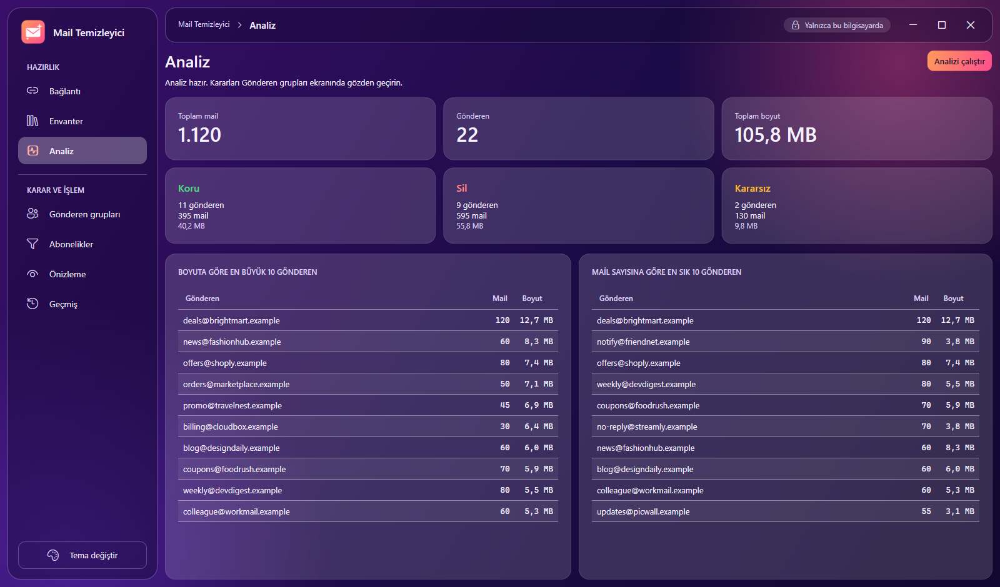
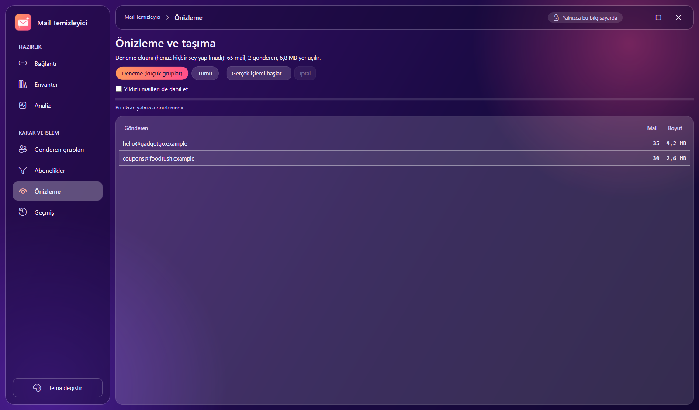
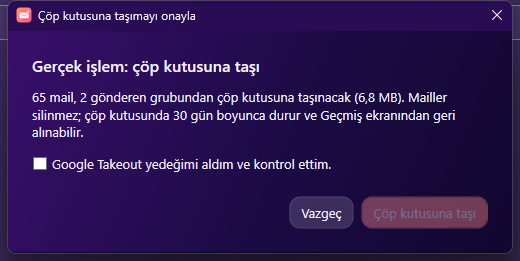
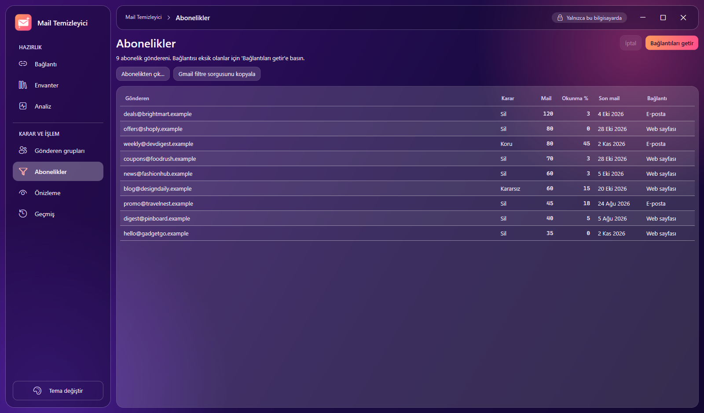
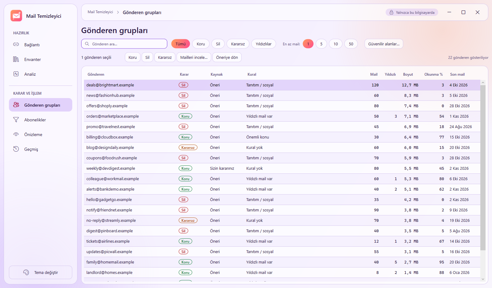
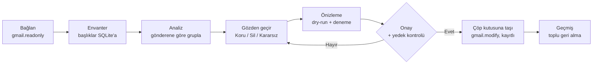

# Mail Temizleyici

**Uzun süredir kullanılan bir Gmail hesabını yalnızca kendi bilgisayarınızda analiz eden ve onayınızla gereksiz mailleri çöp kutusuna taşıyan Windows masaüstü uygulaması. Hiçbir şeyi kalıcı olarak silmez, mail içeriğini indirmez ve hiçbir üçüncü tarafa erişim vermez.**

[English README](README.md)

[](https://github.com/CenkCey/mail-temizleyici/actions/workflows/ci.yml)




> Mail Temizleyici bağımsız bir açık kaynak projedir; Google ile bağlantısı, onayı veya desteği yoktur.
> "Gmail" ve "Google" Google LLC'nin ticari markalarıdır. **Kendi** Google Cloud projenizi ve OAuth
> istemcinizi kullanırsınız; yazarla veya başkasıyla hiçbir şey paylaşılmaz.

## Neden

Yıllar içinde bülten, bildirim ve reklam maillerinden oluşan on binlerce mail birikir ve hangisinin
önemli olduğunu ayırt etmek zorlaşır. Toplu silme araçları risklidir: tam erişime sahip çevrimiçi
servislerdir ve yanlış bir kural önemli bir maili yok edebilir. Mail Temizleyici bunun tersini yapar:

- **Önce oku, sonra işlem yap.** Salt okunur izinle başlar ve hesabınızın yerel bir haritasını çıkarır.
- **Mail başına değil, gönderen başına karar.** Binlerce tek mail yerine "X mağazasının tanıtımları" gibi
  gruplara bakarsınız.
- **Silme yok, çöp kutusu var.** Mailler çöp kutusuna gider (30 gün geri alınabilir) ve her taşıma
  uygulamanın kendi kaydından geri alınabilir.
- **Son söz sizde.** Araç öneri yapar; gerçek işlemden önce her zaman deneme önizlemesi ve açık onay gelir.

## Özellikler

| Alan | Ne yapar |
| --- | --- |
| Envanter | Mail başlıklarını (gönderen, konu, tarih, boyut, etiketler) yerel SQLite veritabanına alır. Kaldığı yerden devam eder, kotaya uyar, hız ve kalan süreyi gösterir. "Yeni mailleri al" yalnızca sonradan gelenleri çeker. |
| Analiz | Mailleri gönderene göre gruplar, adet, boyut ve okunma oranı hesaplar, şeffaf kurallarla Koru, Sil veya Kararsız önerir. |
| Gönderen grupları | Arama, karar filtreleri, yıldızlı filtresi, en az mail sayısı, toplu karar, mail listesi (Gmail'de açma) ve düzenlenebilir güvenilir alan listesi içeren tablo. |
| Abonelikler | `List-Unsubscribe` başlığı olan göndericileri listeler, abonelik bağlantılarını alır, filtre için hazır Gmail arama sorgusu kopyalar. |
| Önizleme ve taşıma | Varsayılan olarak dry-run. Deneme modu önce birkaç küçük grubu taşır. Gerçek işlemden önce onay penceresi (varsayılan düğme: Vazgeç) ve yedek hatırlatması gelir. |
| Geçmiş ve geri alma | Her taşıma toplu işlem olarak kaydedilir; geri alma özgün etiketleri döndürür. |
| Çoklu hesap | Her Gmail hesabı için ayrı veritabanı; hesap değişince tüm ekranlar o hesabın verisine döner. |
| Görünüm | Koyu ve açık tema, cam paneller, klavye erişimi, temaya uygun başlık çubuğu. |

## Ekran görüntüleri

| | |
| --- | --- |
|  |  |
|  |  |
|  |  |

Tüm görüntüler `tools/DemoData` ile üretilen kurgusal demo veriyi (`*.example` adresleri) gösterir.

## Nasıl çalışır



Kurallar yukarıdan aşağı değerlendirilir ve **Koru kuralları Sil kurallarından her zaman önce gelir**
(yıldızlı mail, yanıtladığınız kişiler, kendi etiketleriniz, güvenilir alanlar, fatura veya bilet gibi
önemli konular, ek dosyalar). Ancak ondan sonra tanıtım, sosyal, okunmayan bültenler ve eski bildirimler
Sil olarak önerilir. Kuralların yerleştiremediği her şey *Kararsız* kalır ve otomatik olarak işlenmez.
Ayrıntı: [docs/CLASSIFICATION.md](docs/CLASSIFICATION.md).

## Tasarım gereği güvenlik

1. Mailler yalnızca çöp kutusuna taşınır (`batchModify`). `messages.delete`, `batchDelete` ve
   `https://mail.google.com/` kapsamı kodun hiçbir yerinde yoktur.
2. Çöpe taşıma adımına kadar yalnızca `gmail.readonly`; sonra ayrı oturumla `gmail.modify`.
3. Yalnızca başlıklar: `From`, `To`, `Subject`, `Date`, `List-Unsubscribe`. İçerik indirilmez.
4. Gizli dosyalar (`client_secret.json`, token) depo dışında, kullanıcı profilinde durur.
5. Her gerçek işlemden önce dry-run ve varsayılanı "Vazgeç" olan açık onay gelir.
6. Her taşıma gerçekleşmeden önce kaydedilir; geri alma her zaman kayıttan çalışır.
7. Koru, Sil'den önce gelir; Kararsız grup otomatik işlenmez.
8. Kota hataları üstel bekleme ile yeniden denenir; yarım kalan envanter kaldığı yerden sürer.

Daha fazlası: [docs/SAFETY.md](docs/SAFETY.md) ve [SECURITY.md](SECURITY.md).

## Hızlı başlangıç

Gereksinimler: Windows 10/11, [.NET 8 SDK](https://dotnet.microsoft.com/download/dotnet/8.0) (yayınlanmış
bir sürümü çalıştırmak için .NET 8 Desktop Runtime yeterli), bir Google hesabı, ücretsiz bir Google Cloud projesi.

1. [Google Takeout](https://takeout.google.com) ile **yedek alın** (yalnızca "Mail").
2. **Kendi OAuth istemcinizi oluşturun** (Masaüstü uygulaması) ve `client_secret.json` dosyasını
   `%APPDATA%\MailTemizleyici\` klasörüne koyun. Adım adım: [docs/KURULUM.md](docs/KURULUM.md).
3. **Derleyip çalıştırın:**

   ```
   git clone https://github.com/CenkCey/mail-temizleyici.git
   cd mail-temizleyici
   dotnet run --project src/MailTemizleyici.Desktop
   ```

4. Soldaki menüde ekranları yukarıdan aşağı izleyin. Ekran görüntülü tam anlatım
   [kullanım kılavuzunda](docs/USER_GUIDE.tr.md).

Çalıştırılabilir klasör üretmek için:

```
dotnet publish src/MailTemizleyici.Desktop -c Release -r win-x64 --self-contained false -o publish
```

### Hesabınız olmadan deneyin

```
set MAILTEMIZLEYICI_DATA_DIR=%TEMP%\mail-temizleyici-demo
dotnet run --project tools/DemoData
dotnet run --project src/MailTemizleyici.Desktop
```

Bu, tüm ekranlarda gezinebilmeniz için kurgusal bir hesap yükler. Gerçek veri klasörünüze dokunulmaz.

## Hız ve kotalar

Gmail API her kullanıcıyı dakikada 6.000 kota birimiyle sınırlar ve bir mailin başlıklarını okumak 20 birim
tutar; bu yüzden üst sınır dakikada yaklaşık 300 maildir (100.000 mailli bir hesap yaklaşık altı saat
sürer, durdurursanız envanter devam eder). Uygulama bu sınırın %90'ını hedefler, yalnızca başarısız
istekleri yeniden dener ve her parçayı hemen kaydeder. Arka plan ve ölçümler:
[docs/INVENTORY_SPEED.md](docs/INVENTORY_SPEED.md).

## Teknolojiler

.NET 8 üzerinde C# 12 · MVVM ile WPF ([CommunityToolkit.Mvvm](https://github.com/CommunityToolkit/dotnet)) ·
Gmail API v1 ([Google.Apis.Gmail.v1](https://github.com/googleapis/google-api-dotnet-client)) ·
SQLite ([Microsoft.Data.Sqlite](https://learn.microsoft.com/dotnet/standard/data/sqlite/)) ·
xUnit · GitHub Actions. Telemetri yok, Gmail API dışında ağ çağrısı yok.

## Proje yapısı

```
src/MailTemizleyici.Core      Gmail, SQLite, sınıflandırma, hız sınırlama, geri alma (arayüzden bağımsız)
src/MailTemizleyici.Desktop   WPF görünümleri ve view model'ler, temalar, varlıklar
tests/MailTemizleyici.Tests   Core için xUnit testleri (Gmail testlerde hep taklit edilir)
tools/DemoData                Geçici klasöre kurgusal demo hesap yazar
docs/                         Kılavuzlar, mimari, güvenlik, tasarım, sınıflandırma kuralları
```

## Dokümantasyon

- [Kullanım kılavuzu](docs/USER_GUIDE.tr.md) · [User guide (English)](docs/USER_GUIDE.md)
- [Kurulum: Google Cloud ve OAuth](docs/KURULUM.md) · [Setup (English)](docs/SETUP.md)
- [Mimari](docs/ARCHITECTURE.md) · [Güvenlik modeli](docs/SAFETY.md) · [Sınıflandırma kuralları](docs/CLASSIFICATION.md)
- [Yapay zeka ile geliştirme](docs/AI_ASSISTED_DEVELOPMENT.tr.md) · [AI-assisted development (English)](docs/AI_ASSISTED_DEVELOPMENT.md)
- [Tasarım sistemi](docs/DESIGN.md) · [Envanter hızı araştırması](docs/INVENTORY_SPEED.md) · [Yol haritası](docs/ROADMAP.md)

## Sınırlamalar

- Yalnızca Windows (WPF). Core kütüphanesi ve testler platformdan bağımsızdır.
- Arayüz Türkçedir. Çeviri, kaynak metinleri meselesidir; katkılar memnuniyetle karşılanır.
- OAuth onay ekranı "Testing" modunda kalır (test kullanıcısı sizsiniz), bu yüzden Google yaklaşık 7
  günde bir yeniden giriş ister.
- Envanter hızını uygulama değil, Gmail API kotası belirler.
- Yalnızca başlıklara baktığı için içeriği değerlendiremez. Bu bilinçli bir tercihtir.

## Yapay zeka desteğiyle geliştirildi

Bu kod tabanının büyük kısmı, insan yönlendirmesiyle bir yapay zeka kodlama asistanıyla (Claude Code) yazıldı;
testler, incelemeler ve canlı kullanımla denetlendi. Araçların nasıl kullanıldığı, kimin neye karar verdiği ve
yolda neler ters gittiği: [docs/AI_ASSISTED_DEVELOPMENT.tr.md](docs/AI_ASSISTED_DEVELOPMENT.tr.md).

## Katkı, güvenlik, lisans

[CONTRIBUTING.md](CONTRIBUTING.md), [SECURITY.md](SECURITY.md) ve [LICENSE](LICENSE) (MIT) dosyalarına bakın.
