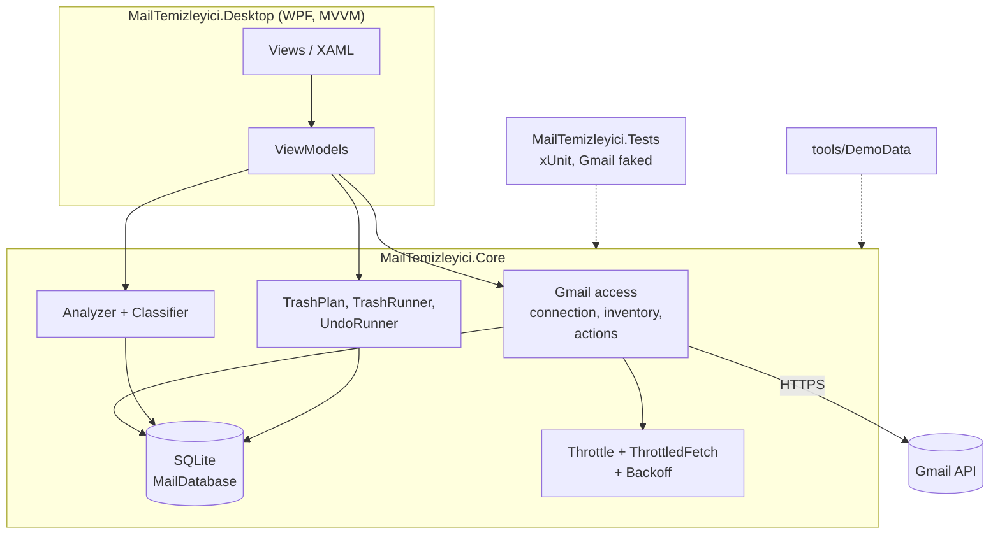
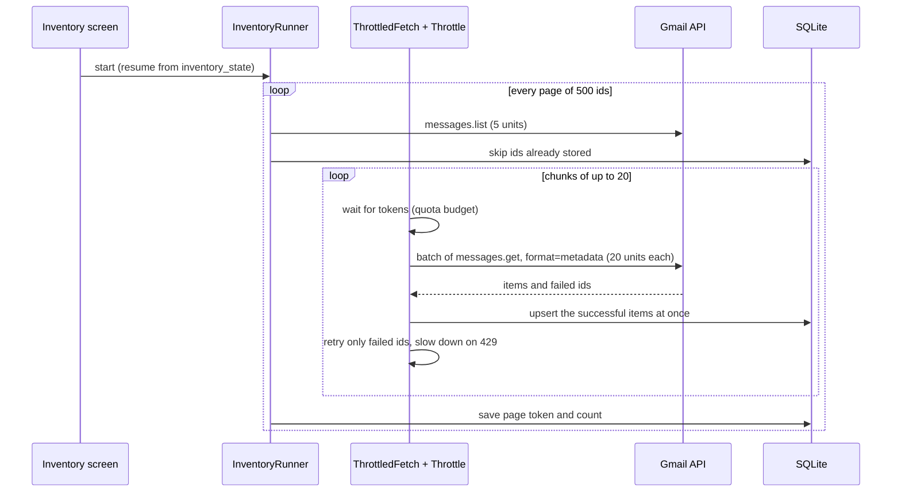

# Architecture

## Overview

Mail Temizleyici is a three-project .NET 8 solution. All logic that decides what happens to a mail is
in a UI-independent library that is covered by unit tests; the WPF application only shows state and
forwards user intent.

| Project | Responsibility |
| --- | --- |
| `src/MailTemizleyici.Core` | Gmail API access, SQLite storage, classification, throttling, trash and undo. No UI types. |
| `src/MailTemizleyici.Desktop` | Views, view models, themes, assets. No business rules. |
| `tests/MailTemizleyici.Tests` | xUnit tests for Core. The Gmail service is replaced by delegates and fakes, so no test needs a network or an account. |
| `tools/DemoData` | Console tool that writes a fictional mailbox into a scratch data folder (screenshots, demos). |

## Data folder

Everything the app stores lives in one folder: `%APPDATA%\MailTemizleyici\`, or the folder named by
the `MAILTEMIZLEYICI_DATA_DIR` environment variable.

| File | Content |
| --- | --- |
| `client_secret.json` | The user's own OAuth client (never created or modified by the app). |
| `Google.Apis.Auth...-user`, `...-user-modify` | OAuth tokens for the read-only and the modify scope, written by the Google client library. |
| `veri\<account>.db` | One SQLite database per Gmail account. |
| `active_account.txt` | The account the screens currently show. |
| `allowlist.txt` | Trusted domains, one per line (defaults are used until the user saves a list). |

## Data model (SQLite)

| Table | Purpose |
| --- | --- |
| `message` | One row per mail: id, thread id, sender address and name, domain, subject, date, size, labels, read, starred, important, category, has unsubscribe header, has attachment, recipients (only for sent mail). Headers and metadata only. |
| `inventory_state` | Single row: page token, fetched count, started and finished time. Makes the inventory resumable. |
| `sender_summary` | Analysis result per sender: counts, size, dates, read ratio, replied, unsubscribe, suggested decision, rule number, the user's own decision. |
| `sent_contact` | Addresses the user has written to (from sent mail). |
| `action_log` | One row per mail moved to Trash: message id, action, time, batch number, undone flag. The undo source. |
| `account` | The Gmail account the database belongs to; every action checks it. |
| `sender_unsubscribe` | Best `List-Unsubscribe` link per sender. |

## Key flows

### Inventory

- **Throttle** is a token bucket that spends quota units, not seconds: 5,400 units per minute (90 % of
  the 6,000 per-user limit), `messages.get` costs 20 units. After a rate-limit error it blocks for 5, 10,
  20 … 60 seconds, lowers the rate by 20 % (floor 40 %) and shrinks the batch (floor 5); every success
  restores both step by step.
- **ThrottledFetch** retries only the failed ids, never the successful ones, and gives up with Gmail's own
  message after six rounds without a single success.
- Each chunk is stored immediately, so a crash or cancel loses at most one chunk, and a restart skips
  everything already stored.
- **InventoryRefresh** lists newest first and stops at the first page that contains a mail it already knows.
- **AttachmentSync** and **SubscriptionSync** reuse the same engine (a `has:attachment` search; the newest
  mail of each subscription sender).

### Classification

`Analyzer` aggregates messages per sender, `Classifier` applies the rules in order and the first match
wins ([CLASSIFICATION.md](CLASSIFICATION.md)). Keep rules come first, so an important sender can never be
suggested for Trash by a later rule. A user decision (`Keep`, `Trash`, `Undecided`) overrides the
suggestion and survives re-analysis because `SaveAnalysis` re-applies stored decisions.

### Trash and undo

1. `TrashPlan.Build` collects the mails of senders whose effective decision is Trash, minus mail already
   in Trash by the app, minus starred mail unless the user ticked the box. It refuses to run while the
   inventory is unfinished.
2. `TrashRunner` writes each chunk of 1,000 ids to `action_log` **before** calling `batchModify` (add
   `TRASH`, remove `INBOX`). If Gmail rejects the call the log rows are removed again.
3. `UndoRunner` groups the batch's mails by their original restorable labels (`INBOX`, `UNREAD`,
   `STARRED`, `IMPORTANT`, `CATEGORY_*`, user labels) and restores each group with one `batchModify`
   (remove `TRASH`, add the labels), marking rows undone chunk by chunk.

### Accounts

`AccountMismatchException` is thrown by `MailDatabase.EnsureAccount` before inventory, trash and undo
if the signed-in account differs from the database's account. On top of that every account has its own
database file, "Hesap değiştir" deletes the two token entries (through the Google client's
`DeleteAsync`, never reading them) and the main view model rebuilds every screen's state.

## Gmail API usage

| Scope | Used for | When |
| --- | --- | --- |
| `gmail.readonly` | Profile, `messages.list`, `messages.get` (metadata) | Always |
| `gmail.modify` | `messages.batchModify` (trash and undo) | Only at the trash and undo steps, separate token |

Not used and never requested: `https://mail.google.com/`, `messages.delete`, `messages.batchDelete`,
`gmail.settings.*`. Quota costs, limits and the speed research: [INVENTORY_SPEED.md](INVENTORY_SPEED.md).

## Desktop application

- MVVM with CommunityToolkit.Mvvm (`ObservableObject`, `[RelayCommand]`, cancellable async commands).
- `MainViewModel` owns one view model per screen and rebuilds them on an account change.
- One implicit style per control type; colors, sizes and fonts come from the theme dictionaries
  (`Themes/Dark.xaml`, `Light.xaml`, `Styles.xaml`), see [DESIGN.md](DESIGN.md).
- Custom window chrome (`WindowChrome`) with a themed title bar; dialogs are colored through the DWM API.

## Testing

- ~100 xUnit tests on Core: classification rules, analyzer, inventory resume and retry, throttle with a
  fake clock, throttled fetch, refresh, attachment and subscription sync, trash plan, trash runner, undo,
  account guard, path rules.
- Network access is injected as delegates (`listPage`, `getMetadata`, `trash`, `restore`), so every
  failure mode (429, 403, 404, cancellation) is tested without Gmail.
- CI builds and tests on Windows for every push and pull request and checks for vulnerable packages.

## Design decisions and trade-offs

| Decision | Why | Cost |
| --- | --- | --- |
| Per-sender decisions | Review dozens of groups instead of tens of thousands of mails; fits how bulk mail behaves. | A sender with both promotions and personal mail is judged as a whole; Keep rules (starred, replied, labels) protect the personal part. |
| Headers only | Privacy and speed; no body ever leaves Gmail. | Subjects and headers are the only signals; content-based classification is impossible by design. |
| Trash, not delete | Recoverable for 30 days plus an undo log. | Space is only freed after Gmail empties Trash. |
| Own OAuth client, Testing mode | No shared secret, no verification review, no third-party access. | Tokens expire after 7 days; the user does a one-time Google Cloud setup. |
| SQLite file per account | Complete separation, easy to delete. | Accounts are not compared against each other. |
| Quota-driven throttle | The per-user limit cannot be raised; staying under it avoids wasted retries. | Throughput is capped around 300 mails per minute. |
| WPF | Native Windows look, strong data grid, no web stack. | Windows only. |
