# User guide

This guide walks through the app from the first sign-in to undoing a move. The screenshots use
fictional demo data. The interface itself is in Turkish; the English names of the screens are given in
brackets. A Turkish version is in [USER_GUIDE.tr.md](USER_GUIDE.tr.md).

## Before you start

1. Take a **Google Takeout** backup of your mail (only "Mail"). It is required before the first real
   move to Trash, not before the read-only steps.
2. Create your own OAuth client and put `client_secret.json` in `%APPDATA%\MailTemizleyici\`
   ([SETUP.md](SETUP.md)).
3. Start the app. The left menu is ordered like the workflow: **Bağlantı → Envanter → Analiz →
   Gönderen grupları → Abonelikler → Önizleme → Geçmiş**.

The cleaning flow is always the same:

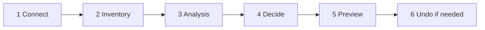

## 1. Connection (Bağlantı)

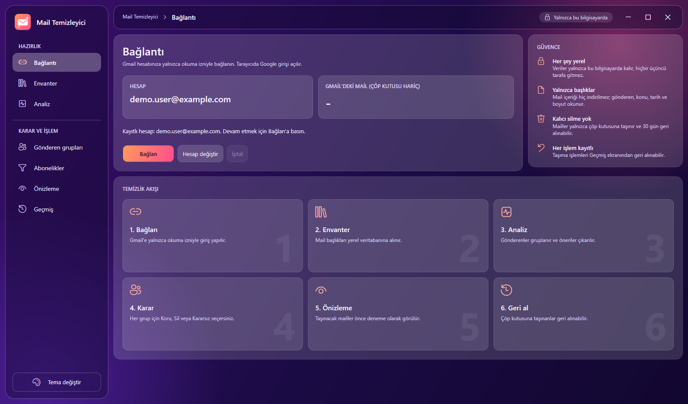

Press **Bağlan** (Connect). Your browser opens Google's sign-in page; choose the account and allow
read-only access. Google may warn that the app is "not verified": this is normal because it is your own
project in Testing mode, choose *Advanced → continue*.

- **Hesap** shows the connected account, **Gmail'deki mail (çöp kutusu hariç)** shows Gmail's own
  count of mail *outside* Trash.
- **Hesap değiştir** (Switch account) signs out, opens the sign-in again and, if you pick another
  account, replaces every screen with that account's own data. Each account has its own database,
  switching never mixes or deletes data. Going back to an account you used before shows its earlier
  inventory and history again.
- The panel on the right repeats the guarantees: everything is local, only headers are read, nothing
  is deleted permanently, every move can be undone.

## 2. Inventory (Envanter)

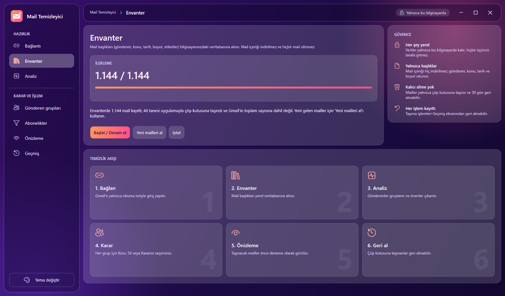

**Başlat / Devam et** (Start / Continue) reads the headers of every mail into the local database. Mail
bodies are not downloaded.

- Keep the window open. You can cancel at any time; the next start continues where it stopped and
  skips mail that is already stored.
- The screen shows `fetched / total`, the speed in mails per minute and the estimated time left. The
  Gmail API allows about 300 mails per minute, so a very large mailbox takes hours
  ([INVENTORY_SPEED.md](INVENTORY_SPEED.md)).
- When it finishes, attachment information is filled in with a separate search.
- **Yeni mailleri al** (Fetch new mail) is for later: it fetches only mail that arrived after the last
  inventory.
- Gmail's total on the Connection screen excludes Trash while the inventory includes mail you moved to
  Trash with this app. The status line explains the difference ("N of them were moved to Trash with the
  app").

## 3. Analysis (Analiz)

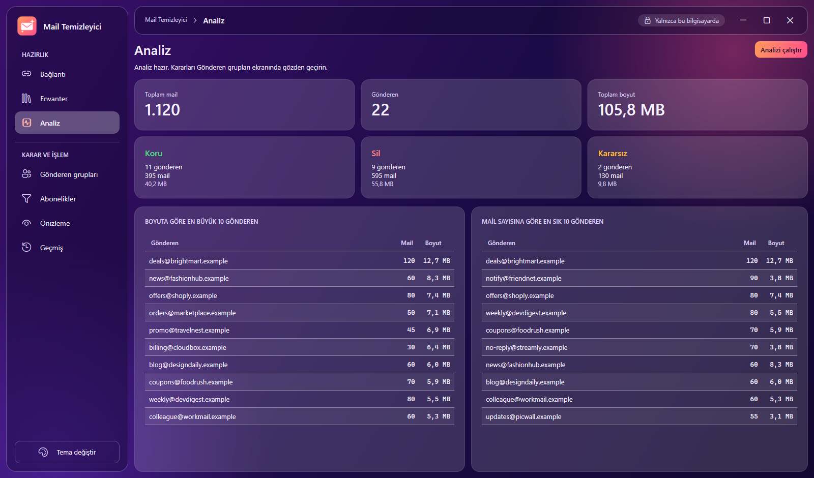

**Analizi çalıştır** groups the inventory by sender and applies the classification rules. The cards show
how many senders, mails and megabytes fall into each suggestion:

- **Koru** (Keep): important, never moved automatically.
- **Sil** (Trash): suggested for Trash.
- **Kararsız** (Undecided): no rule matched. Nothing happens to it until you decide.

The two tables list the biggest senders by size and by count, usually where the space goes.
Run the analysis again after a new inventory, after fetching new mail, or after changing the
trusted-domain list.

## 4. Sender groups (Gönderen grupları)

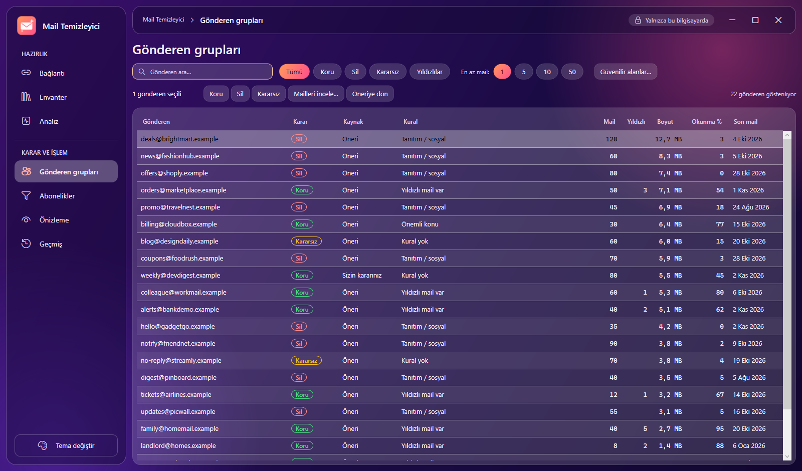

This is where you decide. Every row is one sender.

| Column | Meaning |
| --- | --- |
| Karar | The current decision as a badge: Koru, Sil, Kararsız (never shown by color alone). |
| Kaynak | *Öneri* (suggestion by the rules) or *Sizin kararınız* (your own choice). |
| Kural | The rule that produced the suggestion, e.g. "Tanıtım / sosyal", "Yıldızlı mail var". |
| Mail, Yıldızlı, Boyut, Okunma %, Son mail | Count, number of starred mails, total size, share you opened, newest mail. |

Tools above the table:

- **Search** by address, **decision filters** (Tümü, Koru, Sil, Kararsız), **Yıldızlılar** (senders with
  starred mail) and **En az mail** (minimum number of mails: 1, 5, 10, 50).
- Select one or many rows (Ctrl+A selects all) and press **Koru**, **Sil** or **Kararsız** to decide in
  bulk. **Öneriye dön** removes your choice and returns to the rule's suggestion. Your decisions
  survive a new analysis.
- **Güvenilir alanlar…** opens the list of trusted domains. Mail from these domains is always Keep.
  One domain per line, subdomains are included. Run the analysis again afterwards.
- **Mailleri incele…** (or double-click a row) lists that sender's mails from the local database
  (date, subject, size, read or starred). **Gmail'de aç** opens the selected mail in your browser. The
  app never downloads or shows the content itself.

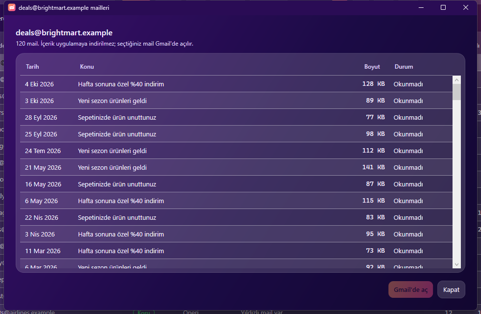

Review the *Sil* groups before you go on. Starred mail from a *Sil* sender is skipped by default.

## 5. Subscriptions (Abonelikler)

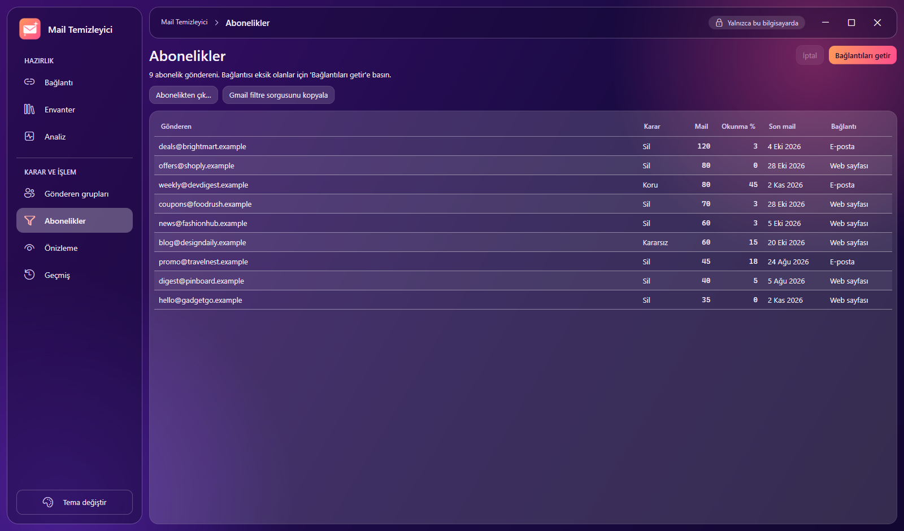

Lists senders whose mails carry a `List-Unsubscribe` header.

- **Bağlantıları getir** reads the header of each sender's newest mail and stores the unsubscribe
  link (web page or e-mail address).
- **Abonelikten çık…** opens that link in your browser after a confirmation. Only unsubscribe from
  senders you recognize.
- **Gmail filtre sorgusunu kopyala** copies a search such as `from:(a@x OR b@y)` for the selected rows.
  Paste it into Gmail's search box and choose *Create filter*. The app does not create filters itself,
  that would need an extra permission.

## 6. Preview and move to Trash (Önizleme)

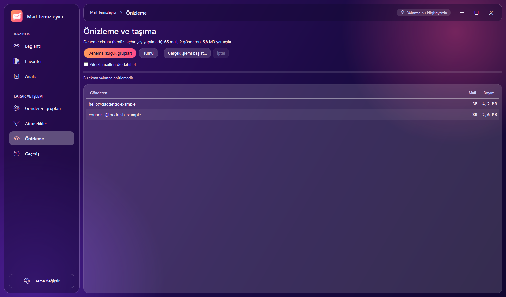

The preview is a **dry run**: nothing has happened yet. It lists every sender with a *Sil* decision, how
many mails would move and how much space it frees.

- **Deneme (küçük gruplar)** (Trial): only the smallest groups, at most about 100 mails. Always start
  here and check the result in Gmail.
- **Tümü** (All): every mail of every *Sil* sender.
- **Yıldızlı mailleri de dahil et**: off by default. Starred mail is skipped and counted; tick the box
  only if you really want starred mail moved too. The confirmation then names how many starred mails
  are included.
- The inventory must be finished before a plan can be built.

**Gerçek işlemi başlat…** opens the confirmation:

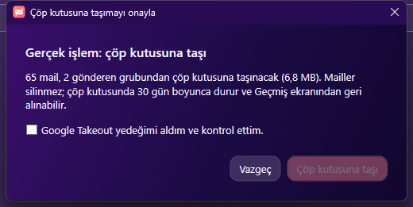

The default button is **Vazgeç** (cancel). "Çöp kutusuna taşı" stays disabled until you confirm you took
the Takeout backup. The first time, Google asks for the extra `gmail.modify` permission in the browser.
Mail is moved with Gmail's own Trash, where it stays for 30 days, and every move is written to the log
*before* it happens.

## 7. History and undo (Geçmiş)

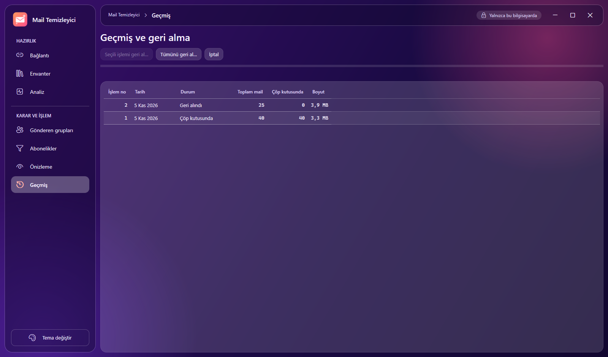

Each move is a numbered batch. **Seçili işlemi geri al…** restores one batch, **Tümünü geri al…**
restores every batch that still has mail in Trash. Undo puts the mail back into the Inbox with its
original labels (unread, starred, important, categories, your labels). Both ask for confirmation, the
default answer is "No".

## Themes and accessibility

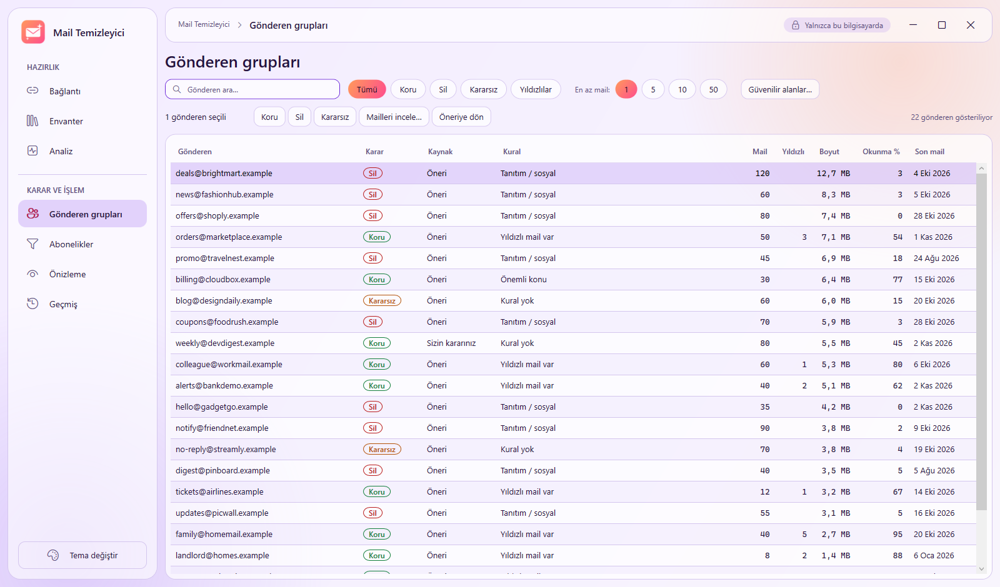

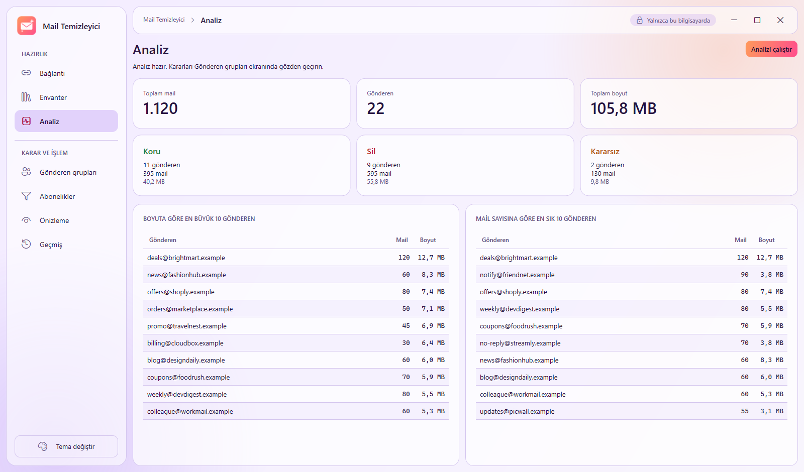

**Tema değiştir** switches between dark and light. Everything works with the keyboard; focus rings are
always visible; decisions are never conveyed by color alone.

## Frequently asked questions

**The numbers on the Connection and Inventory screens differ.** Gmail's count excludes Trash; the
inventory includes mail you moved to Trash through the app. Undo them on the History screen to make the
numbers match.

**"No new mail" although I restored mail.** Restored mail keeps its Gmail ids, so it is already in the
inventory. Nothing is new.

**Why was starred mail not moved although the sender is on Sil?** By design. Tick *Yıldızlı mailleri
de dahil et* on the preview screen to include it.

**How long does the inventory take?** About 250–300 mails per minute at best. 10,000 mails ≈ 35–40
minutes, 100,000 ≈ 6 hours. It resumes after a stop.

**Google asks me to sign in again after a week.** Projects in Testing mode expire tokens after 7 days.
Just press *Bağlan* again.

**Can mail be lost?** The app never deletes permanently. Mail in Trash is removed by Gmail itself after
30 days, so check the result and undo within that time. The Takeout backup is your second safety net.

**Where is my data?** In `%APPDATA%\MailTemizleyici\veri\<your address>.db` (SQLite). Delete the file to
forget an account. To remove everything, delete the `MailTemizleyici` folder and revoke access at
<https://myaccount.google.com/permissions>.

**Can I try it without my mailbox?** Yes, see "Try it without a mailbox" in the [README](../README.md).
