# Kullanım kılavuzu

Bu kılavuz uygulamayı ilk girişten bir taşımayı geri almaya kadar adım adım anlatır. Ekran görüntüleri
kurgusal demo veri kullanır. İngilizce sürüm: [USER_GUIDE.md](USER_GUIDE.md).

## Başlamadan önce

1. Mailinizin **Google Takeout** yedeğini alın (yalnızca "Mail"). İlk gerçek çöpe taşımadan önce şarttır,
   salt okunur adımlar için gerekmez.
2. Kendi OAuth istemcinizi oluşturup `client_secret.json` dosyasını `%APPDATA%\MailTemizleyici\`
   klasörüne koyun ([KURULUM.md](KURULUM.md)).
3. Uygulamayı başlatın. Soldaki menü iş akışı sırasındadır: **Bağlantı → Envanter → Analiz → Gönderen
   grupları → Abonelikler → Önizleme → Geçmiş**.

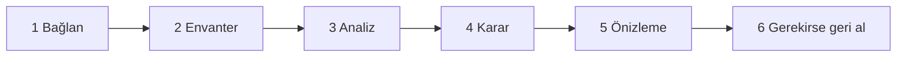

## 1. Bağlantı

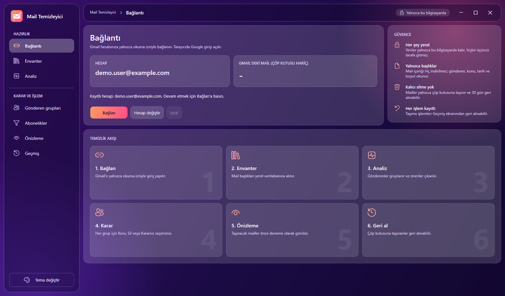

**Bağlan**'a basın. Tarayıcınızda Google giriş sayfası açılır; hesabı seçin ve salt okunur erişime izin
verin. Google uygulamanın "doğrulanmadığını" söyleyebilir; bu normaldir, çünkü Testing modundaki kendi
projenizdir, *Gelişmiş → devam* deyin.

- **Hesap** bağlı hesabı, **Gmail'deki mail (çöp kutusu hariç)** Gmail'in çöp kutusu dışındaki mail
  sayısını gösterir.
- **Hesap değiştir** oturumu kapatır, girişi yeniden açar ve başka bir hesap seçerseniz tüm ekranları o
  hesabın kendi verisiyle değiştirir. Her hesabın ayrı veritabanı vardır, geçiş veriyi asla karıştırmaz
  veya silmez. Daha önce kullandığınız hesaba dönünce eski envanter ve geçmiş yeniden görünür.
- Sağdaki panel güvenceleri tekrar eder: her şey yereldir, yalnızca başlıklar okunur, kalıcı silme yoktur,
  her taşıma geri alınabilir.

## 2. Envanter

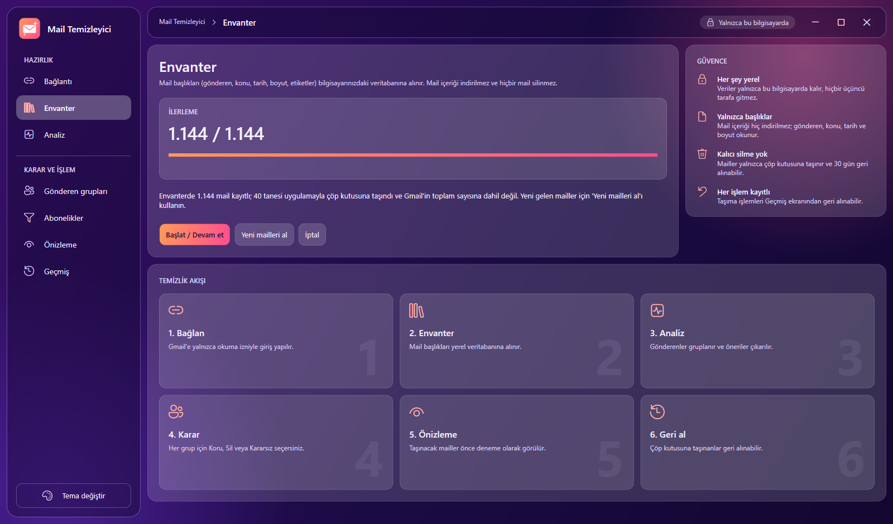

**Başlat / Devam et** her mailin başlığını yerel veritabanına alır. Mail içerikleri indirilmez.

- Pencereyi açık tutun. İstediğiniz an iptal edebilirsiniz; sonraki başlatma kaldığı yerden devam eder ve
  kayıtlı mailleri atlar.
- Ekran `alınan / toplam`, dakikadaki mail hızını ve tahmini kalan süreyi gösterir. Gmail API dakikada
  yaklaşık 300 maile izin verir; çok büyük bir hesap saatler sürer ([INVENTORY_SPEED.md](INVENTORY_SPEED.md)).
- Bitince ek dosya bilgisi ayrı bir aramayla doldurulur.
- **Yeni mailleri al** daha sonrası içindir: son envanterden sonra gelen mailleri çeker.
- Bağlantı ekranındaki Gmail toplamı çöp kutusunu içermez, envanter ise bu uygulamayla çöpe taşıdığınız
  mailleri içerir. Durum satırı farkı açıklar ("N tanesi uygulamayla çöp kutusuna taşındı").

## 3. Analiz

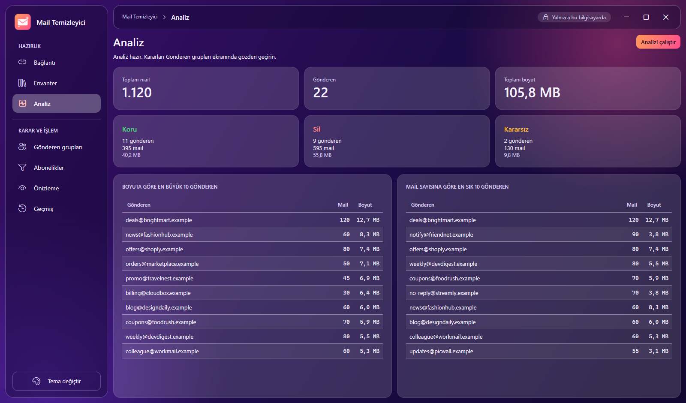

**Analizi çalıştır** envanteri gönderene göre gruplar ve sınıflandırma kurallarını uygular. Kartlar her
öneriye kaç gönderen, mail ve megabayt düştüğünü gösterir:

- **Koru**: önemli, otomatik olarak asla taşınmaz.
- **Sil**: çöp kutusu için önerilir.
- **Kararsız**: hiçbir kural eşleşmedi. Siz karar verene kadar hiçbir şey yapılmaz.

İki tablo en büyük göndericileri boyuta ve adede göre listeler; alanın nereye gittiğini genelde buradan görürsünüz.
Yeni envanterden, yeni mailleri aldıktan veya güvenilir alan listesini değiştirdikten sonra analizi yeniden çalıştırın.

## 4. Gönderen grupları

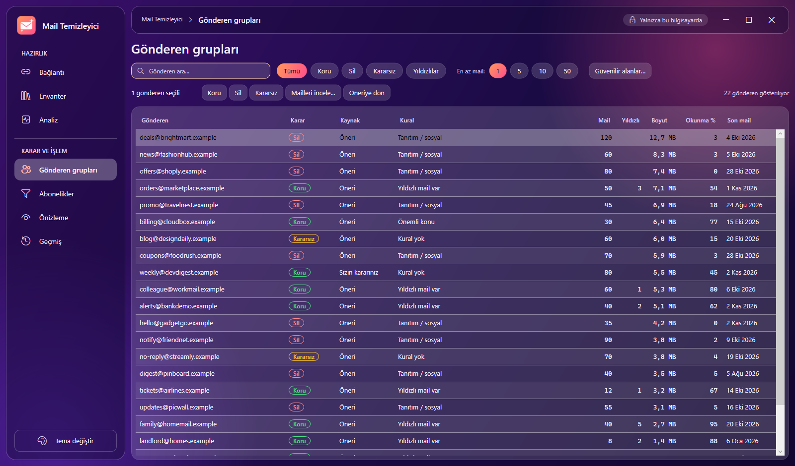

Karar burada verilir. Her satır bir göndericidir.

| Sütun | Anlamı |
| --- | --- |
| Karar | Mevcut karar rozeti: Koru, Sil, Kararsız (asla yalnızca renkle gösterilmez). |
| Kaynak | *Öneri* (kurallar) veya *Sizin kararınız*. |
| Kural | Öneriyi üreten kural, ör. "Tanıtım / sosyal", "Yıldızlı mail var". |
| Mail, Yıldızlı, Boyut, Okunma %, Son mail | Adet, yıldızlı mail sayısı, toplam boyut, açtığınız oran, en yeni mail. |

Tablonun üstündeki araçlar:

- Adrese göre **arama**, **karar filtreleri** (Tümü, Koru, Sil, Kararsız), **Yıldızlılar** (yıldızlı maili
  olan göndericiler) ve **En az mail** (1, 5, 10, 50).
- Bir veya birden çok satır seçin (Ctrl+A tümünü seçer) ve toplu karar için **Koru**, **Sil** veya
  **Kararsız**'a basın. **Öneriye dön** kendi kararınızı kaldırıp kuralın önerisine döndürür. Kararlarınız
  yeni analizden etkilenmez.
- **Güvenilir alanlar…** her zaman korunacak alan adları listesini açar. Bu alanlardan gelen mailler her
  zaman Koru olur. Her satıra bir alan adı yazın, alt alan adları dahildir. Sonra analizi yeniden çalıştırın.
- **Mailleri incele…** (veya satıra çift tıklama) göndericinin maillerini yerel veritabanından listeler
  (tarih, konu, boyut, okundu veya yıldızlı). **Gmail'de aç** seçili maili tarayıcıda açar. Uygulama içeriği
  hiçbir zaman kendisi indirmez veya göstermez.

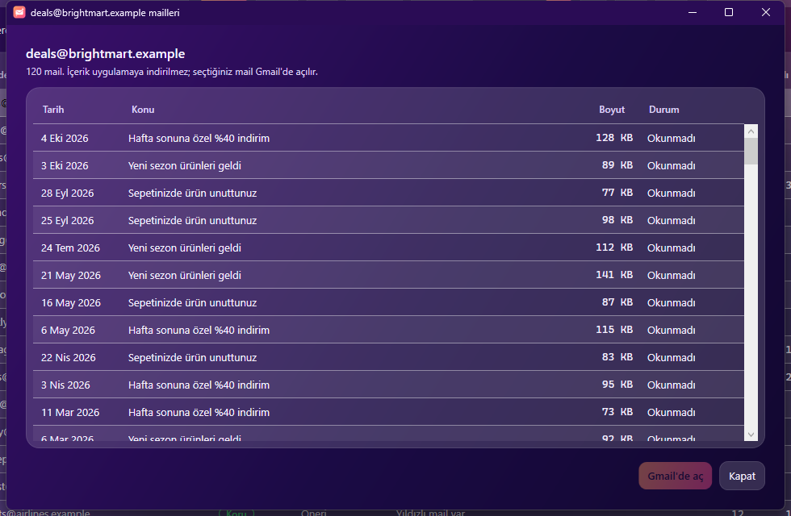

Devam etmeden önce *Sil* gruplarını gözden geçirin. *Sil* göndericisinin yıldızlı maili varsayılan olarak atlanır.

## 5. Abonelikler

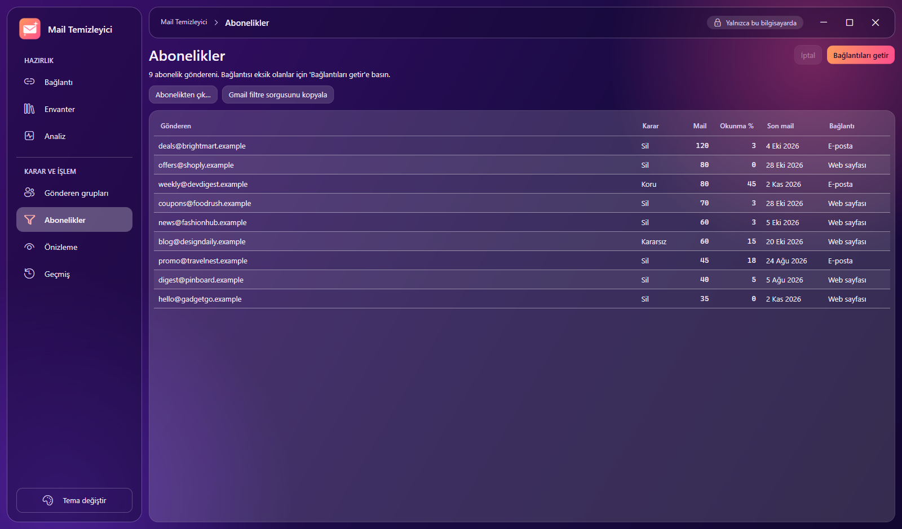

Mailleri `List-Unsubscribe` başlığı taşıyan göndericileri listeler.

- **Bağlantıları getir** her göndericinin en yeni mailinin başlığını okuyup abonelik bağlantısını (web
  sayfası veya e-posta adresi) kaydeder.
- **Abonelikten çık…** onaydan sonra bağlantıyı tarayıcıda açar. Yalnızca tanıdığınız göndericilerden
  abonelikten çıkın.
- **Gmail filtre sorgusunu kopyala** seçili satırlar için `from:(a@x OR b@y)` gibi bir arama kopyalar.
  Gmail arama kutusuna yapıştırın, *Filtre oluştur*'u seçin. Uygulama filtreyi kendisi oluşturmaz, bunun
  için ek izin gerekirdi.

## 6. Önizleme ve çöpe taşıma

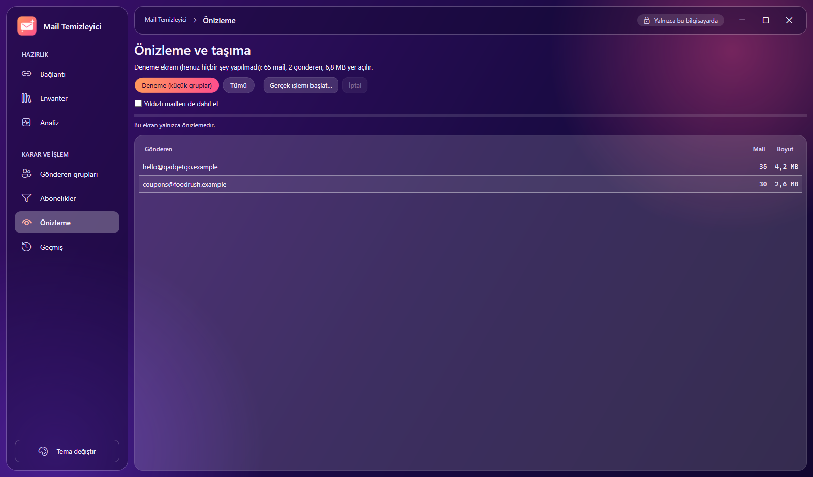

Önizleme bir **dry-run**'dır: henüz hiçbir şey yapılmadı. *Sil* kararlı her göndericiyi, kaç mailin
taşınacağını ve ne kadar yer açılacağını listeler.

- **Deneme (küçük gruplar)**: yalnızca en küçük gruplar, en fazla yaklaşık 100 mail. Her zaman buradan
  başlayın ve sonucu Gmail'de kontrol edin.
- **Tümü**: her *Sil* göndericisinin tüm mailleri.
- **Yıldızlı mailleri de dahil et**: varsayılan kapalı. Yıldızlı mailler atlanır ve sayılır; yalnızca
  gerçekten taşınmasını istiyorsanız işaretleyin. Onay penceresi dahil edilen yıldızlı mail sayısını söyler.
- Plan oluşturulabilmesi için envanterin bitmiş olması gerekir.

**Gerçek işlemi başlat…** onay penceresini açar:

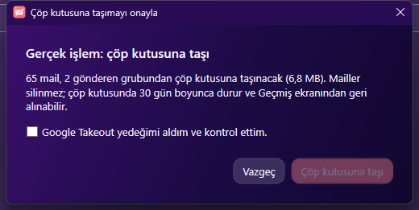

Varsayılan düğme **Vazgeç**'tir. "Çöp kutusuna taşı", Takeout yedeği aldığınızı onaylayana kadar kapalı
kalır. İlk seferde Google tarayıcıda ek `gmail.modify` izni ister. Mailler Gmail'in kendi çöp kutusuna
taşınır, orada 30 gün kalır ve her taşıma gerçekleşmeden *önce* kayda yazılır.

## 7. Geçmiş ve geri alma

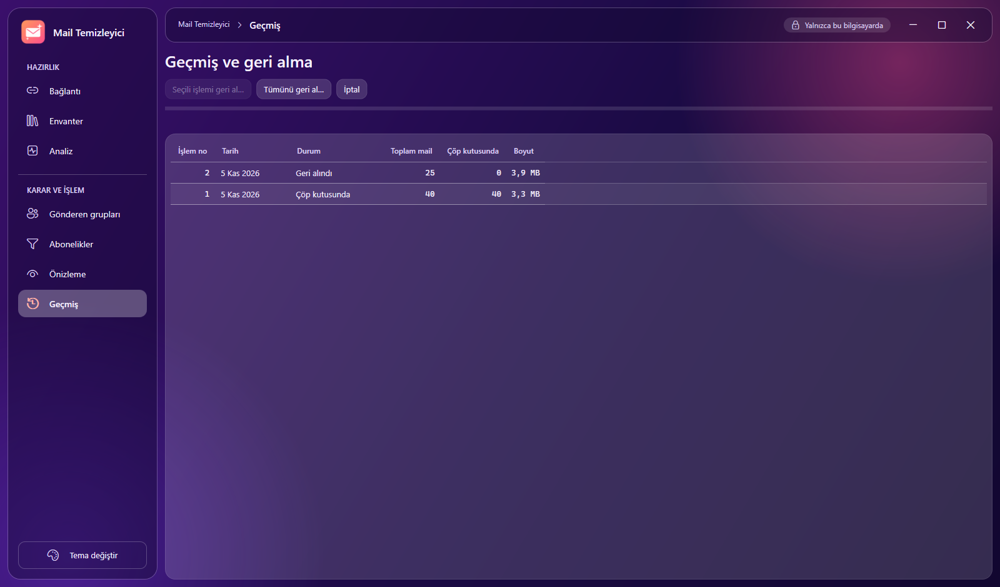

Her taşıma numaralı bir işlemdir. **Seçili işlemi geri al…** bir işlemi, **Tümünü geri al…** çöp kutusunda
hâlâ maili olan tüm işlemleri geri getirir. Geri alma, mailleri özgün etiketleriyle (okunmamış, yıldızlı,
önemli, kategoriler, kendi etiketleriniz) Gelen Kutusu'na döndürür. İkisi de onay ister, varsayılan cevap "Hayır".

## Tema ve erişilebilirlik

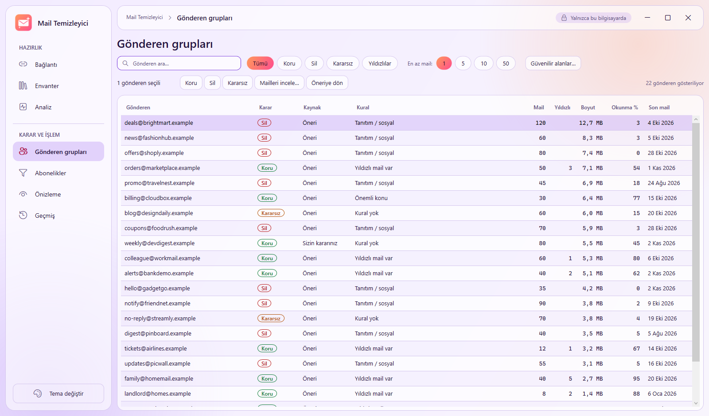

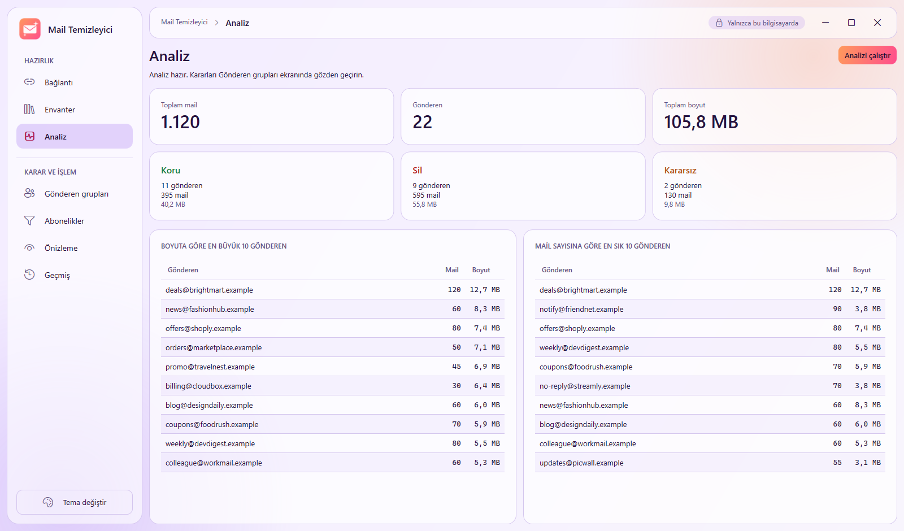

**Tema değiştir** koyu ve açık tema arasında geçiş yapar. Her şey klavyeyle kullanılabilir; odak halkası
her zaman görünür; kararlar asla yalnızca renkle iletilmez.

## Sık sorulan sorular

**Bağlantı ve Envanter ekranlarındaki sayılar farklı.** Gmail'in sayısı çöp kutusunu içermez; envanter
uygulamayla çöpe taşıdığınız mailleri içerir. Sayılar eşitlensin isterseniz Geçmiş ekranından geri alın.

**Mail geri getirdim ama "Yeni mail yok" diyor.** Geri getirilen mailler Gmail kimliklerini korur, yani
envanterde zaten vardır. Yeni sayılmazlar.

**Gönderen Sil'de ama yıldızlı mail neden taşınmadı?** Tasarım gereği. Önizlemede *Yıldızlı mailleri de
dahil et* kutusunu işaretleyin.

**Envanter ne kadar sürer?** En iyi ihtimalle dakikada 250–300 mail. 10.000 mail ≈ 35–40 dakika, 100.000
≈ 6 saat. Durdurunca devam eder.

**Google bir hafta sonra yeniden giriş istiyor.** Testing modundaki projelerin token'ı 7 günde sona erer.
*Bağlan*'a yeniden basmanız yeterli.

**Mail kaybolabilir mi?** Uygulama hiçbir zaman kalıcı silmez. Çöp kutusundaki mail 30 gün sonra Gmail
tarafından silinir; bu süre içinde sonucu kontrol edip geri alın. Takeout yedeği ikinci güvencenizdir.

**Verilerim nerede?** `%APPDATA%\MailTemizleyici\veri\<adresiniz>.db` (SQLite). Bir hesabı unutmak için dosyayı
silin. Her şeyi kaldırmak için `MailTemizleyici` klasörünü silin ve
<https://myaccount.google.com/permissions> adresinden erişimi kaldırın.

**Mail hesabım olmadan deneyebilir miyim?** Evet, [README](../README.tr.md) içindeki "Hesabınız olmadan deneyin" bölümüne bakın.
